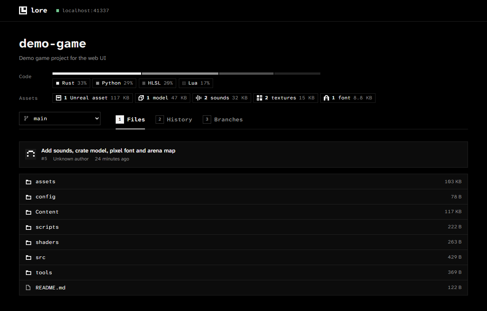
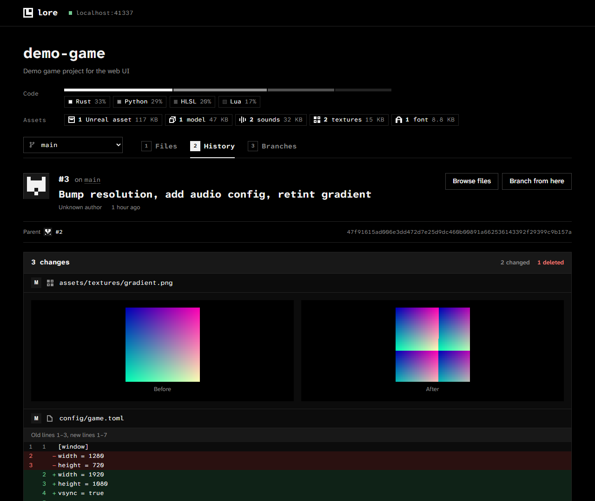

# Lore Web UI

A web interface for [Lore](https://github.com/EpicGames/lore), the open source version control system from Epic Games. Browse repositories, read history, inspect files and diffs, and manage branches from a browser.



## Features

- **Files.** Browse any branch or revision. Text files open with line numbers. Images, audio and video play inline. Everything else downloads.
- **History and diffs.** Each revision shows its changed files with line diffs for text and side-by-side previews for images.
- **Branches.** Create a branch from any revision and delete branches you no longer need. Create new repositories.
- **Repository stats.** Badges show the languages on a branch and its game assets by type: textures, models, sounds, video, fonts, and Unreal, Unity and Godot assets.
- **Keyboard and themes.** Press `1`, `2` or `3` to switch between Files, History and Branches. Light and dark themes follow your system setting.

## Quick start

You need [Bun](https://bun.sh) 1.4 or newer, Node.js 22.17 or newer, and a running Lore server. Setup takes about 2 minutes.

1. Clone the repository and install dependencies:

   ```sh
   git clone https://github.com/juddisjudd/lore-webgui.git
   cd lore-webgui
   bun install
   ```

2. Start the app and point it at your Lore server:

   ```sh
   LORE_HOST=lore.local bun run dev
   ```

   In PowerShell:

   ```powershell
   $env:LORE_HOST = "lore.local"; bun run dev
   ```

3. Open <http://localhost:5173>.

Leave out `LORE_HOST` to connect to a server on `localhost`.

## How it works

Browsers cannot talk to a Lore server directly. Lore speaks gRPC over HTTP/2 and QUIC, and offers no gRPC-Web or CORS support. A small gateway runs next to the web app and translates.

```
browser ──JSON──▶ gateway ──gRPC──▶ Lore server :41337
                          ──HTTP──▶ Lore server :41339  (file content)
```

The project is a Bun workspace with three packages:

| Package | Role |
| --- | --- |
| `packages/api` | The HTTP contract between browser and gateway, written once with [Effect](https://effect.website) `HttpApi` and `Schema`. Both sides import it, so the type checker catches any mismatch between them. |
| `packages/gateway` | A Bun server built with Effect. It calls Lore through gRPC clients generated from Lore's protobuf files, computes text diffs and repository stats, streams file content, and serves the built web app. |
| `packages/web` | A [SvelteKit](https://svelte.dev) single-page app using Svelte 5. |

The gateway also publishes OpenAPI documentation at `/api/docs`.

## Run in production

1. Build the web app:

   ```sh
   bun run build
   ```

2. Start the gateway:

   ```sh
   LORE_HOST=lore.local bun run start
   ```

3. Open <http://localhost:7337>. One process serves both the app and the API.

## Run with Docker

The image contains the built web app and the gateway bundled into a single file. It runs as a non-root user and reports its status through a Docker health check on `/api/health`.

1. Build and start the container:

   ```sh
   LORE_HOST=lore.local docker compose up -d --build
   ```

   In PowerShell:

   ```powershell
   $env:LORE_HOST = "lore.local"; docker compose up -d --build
   ```

2. Open <http://localhost:7337>.

Leave out `LORE_HOST` to reach a Lore server running on the Docker host itself. Compose passes `PORT` and `LORE_TOKEN` through as well.

Without Compose:

```sh
docker build -t lore-webgui .
docker run -d -p 7337:7337 -e LORE_HOST=lore.local lore-webgui
```

## Configuration

The gateway reads these environment variables:

| Variable | Default | Purpose |
| --- | --- | --- |
| `LORE_HOST` | `localhost` | Host of the Lore server. Sets both URLs below. |
| `LORE_GRPC_URL` | `http://$LORE_HOST:41337` | Lore gRPC endpoint. |
| `LORE_HTTP_URL` | `http://$LORE_HOST:41339` | Lore HTTP endpoint, used for file content. |
| `LORE_TOKEN` | none | Bearer token to send when the Lore server requires authentication. |
| `PORT` | `7337` | Port the gateway listens on. |
| `STATIC_DIR` | `packages/web/build` | Folder of the built web app. |
| `MAX_DIFF_BYTES` | `2097152` | Files larger than this are not diffed. |
| `HISTORY_CONCURRENCY` | `16` | Parallel revision lookups per page of history. |

In development, set `GATEWAY_URL` to point the Vite dev server at a gateway on another address. The default is `http://localhost:7337`.

## Repository stats

The badges describe the latest revision of the selected branch. Code badges show languages weighted by file size, the way GitHub counts them. Data and prose files such as Markdown, JSON and TOML do not count. Asset badges show the file count and total size for each asset type.

The gateway classifies files by extension. It skips vendored code and engine output folders, including `ThirdParty`, `Intermediate`, `DerivedDataCache`, `Library` and `node_modules`. Results are cached per revision. Revisions never change, so the cache never needs clearing. The first request for a large repository reads its full file tree once.



## Development

```sh
bun run check   # type checks: tsc for api and gateway, svelte-check for web
bun run test    # gateway unit tests
bun run build   # production build of the web app
```

The generated gRPC code in `packages/gateway/src/gen` is committed. To refresh it after Lore's protobuf files change:

1. Clone [EpicGames/lore](https://github.com/EpicGames/lore) into a folder named `lore` next to this repository.
2. Run `bun run gen`.

## Known limitations

- There is no per-user sign-in. The gateway sends one token, `LORE_TOKEN`, with every request.
- Repositories can only be deleted through the API (`DELETE /api/repositories/:repo`). Lore deletes them permanently, so the UI has no button for it.
- Downloads show no progress bar. Bun drops the `Content-Length` header on streamed responses.
- The server does not implement `ContentDiff` yet, so the gateway computes diffs itself. `RevisionTree` also leaves out the folder you ask for, so the gateway reads it from the parent folder.
- The clone command shown on an empty branch uses the gateway's `LORE_HOST`. A gateway that uses `localhost` shows `localhost` to every visitor.

## License

[MIT](LICENSE)
